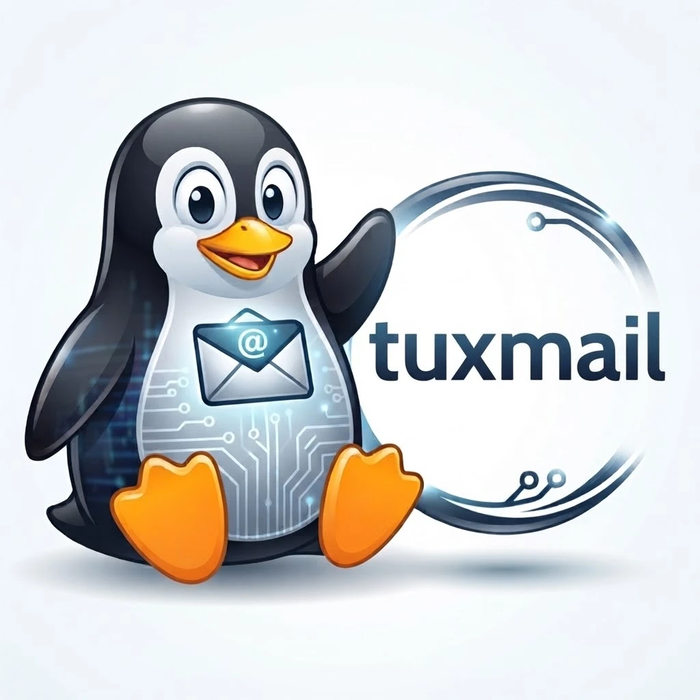

# TuxMail

Plattformübergreifender Kommunikations-Client für **Windows und Linux**:
E-Mail (IMAP/POP3/SMTP, Exchange ActiveSync, Microsoft Graph/EWS, Gmail, JMAP),
Kalender & Aufgaben, Kontakte, Messenger (WhatsApp, Signal, optional Instagram/Facebook/Google)
sowie Cloud-Anhänge über Nextcloud, OpenCloud und Vaultwarden Send.

Besonderheit: Neben der klassischen 3-Spalten-Ansicht gibt es eine **Messenger-artige
Konversationsansicht auch für E-Mails** – beide arbeiten auf denselben Daten und sind
jederzeit umschaltbar.

📄 Das vollständige Entwicklungskonzept: [docs/KONZEPT.md](docs/KONZEPT.md)

**Geplanter Stack:** Go (Kern & Protokolle) · Wails + Svelte 5/TypeScript (Oberfläche) · SQLite (Daten) ·
Messenger als separate Plugin-Prozesse (gRPC) · portabel lauffähig (Windows-ZIP, Linux-AppImage) oder installierbar.

## Lizenz / License

TuxMail ist freie Software unter der **GNU Affero General Public License v3.0 (AGPLv3)** – siehe [LICENSE](LICENSE).
Du darfst TuxMail nutzen, verändern und weitergeben. Wer eine veränderte Version weitergibt **oder als Netzwerkdienst (z. B. Server-Modus) für andere betreibt**, muss den Quellcode dieser Version unter derselben Lizenz zugänglich machen.

TuxMail is free software licensed under the **GNU Affero General Public License v3.0 or later** (`SPDX-License-Identifier: AGPL-3.0-or-later`).

Copyright (C) 2026 Midas Wollinger and TuxMail contributors
